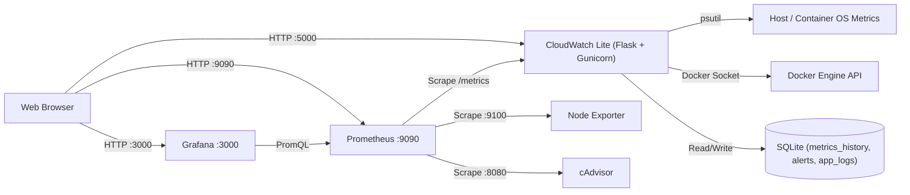

# CloudWatch Lite — Infrastructure & Container Monitoring Platform

A centralized, containerized infrastructure monitoring platform built with **Python Flask**, **psutil**, **Docker SDK**, **Prometheus**, **Grafana**, **Node Exporter**, and **cAdvisor**.

---

## 1. Overview & Objectives

**CloudWatch Lite** collects real-time system and container telemetry, evaluates threshold-based alerts, persists alert and metric history in SQLite, exposes Prometheus metrics, and visualizes everything in both a custom dark-themed SaaS web dashboard and Grafana.

### Key Features
- **Real-Time System Telemetry (`psutil`):** CPU (overall + per-core), RAM, swap, disk utilization/I/O, network traffic/packets, and host/application uptime.
- **Docker Container Monitoring:** Live container inventory, running/stopped counts, and health status via Docker SDK.
- **SaaS Dark-Theme Web Dashboard:** Responsive Bootstrap 5 + Chart.js interface with collapsible sidebar and 11 operational views.
- **Alert Engine & Safe Alert Testing Mode:**
  - Automatic threshold detection: **CPU > 80%**, **RAM > 85%**, **Disk > 90%**, and unhealthy containers.
  - Alert history & acknowledgement stored in SQLite.
  - Dev/test-only simulation endpoint (`POST /api/test/trigger-alert`) labelled `[TEST DATA]`, blocked in `production` mode (`403 Forbidden`).
- **Prometheus & Grafana Stack:** Pre-configured Prometheus scrape targets, alert rules, auto-provisioned datasource, and Grafana overview dashboard.
- **Containerized & Production-Ready:** Multi-stage non-root `Dockerfile` with `HEALTHCHECK` and persistent Docker volumes.

---

## 2. Architecture



---

## 3. Technology Stack

| Layer | Technologies |
| :--- | :--- |
| **Frontend** | HTML5, CSS3, Bootstrap 5, JavaScript, Chart.js |
| **Backend** | Python 3.12, Flask 3.1.0, Gunicorn 23.0.0, SQLite |
| **Telemetry** | `psutil` 6.1.1, Docker SDK for Python 7.1.0, `prometheus-client` 0.21.1 |
| **Monitoring** | Prometheus v2.55.1, Grafana 11.3.1, Node Exporter v1.8.2, cAdvisor v0.49.1 |
| **Containers** | Docker, Docker Compose |
| **Testing & Lint** | `pytest` 8.3.4, `flake8` 7.1.1 |
| **IaC (Planned / Local Init)** | Terraform (AWS provider) |

---

## 4. Project Structure

```text
cloudwatch-lite/
├── app/
│   ├── __init__.py                 # Flask app factory & background collector
│   ├── config.py                   # Environment-based configuration
│   ├── models/
│   │   └── database.py             # SQLite schema & queries
│   ├── monitoring/
│   │   ├── system_metrics.py       # psutil CPU, RAM, disk, network collector
│   │   ├── docker_metrics.py       # Docker SDK container collector
│   │   ├── alert_engine.py         # Threshold evaluation & test alert simulator
│   │   └── prometheus_exporter.py  # Prometheus gauges, counters & histograms
│   ├── routes/
│   │   ├── web.py                  # Dashboard (/) & Prometheus (/metrics)
│   │   └── api.py                  # REST API (/api/*)
│   ├── templates/
│   │   └── index.html              # Dark-themed SaaS dashboard
│   └── static/
│       ├── css/dashboard.css
│       └── js/dashboard.js
├── prometheus/
│   ├── prometheus.yml              # Scrape targets
│   └── alert_rules.yml             # CPU, RAM, Disk & target-up alert rules
├── grafana/
│   ├── provisioning/               # Auto-provisioned datasource & dashboards
│   └── dashboards/
│       └── cloudwatch-lite-overview.json
├── tests/
│   ├── test_api.py
│   └── test_monitoring.py
├── terraform/
│   └── main.tf
├── Dockerfile                      # Multi-stage, non-root Python 3.12 image
├── docker-compose.yml              # Full 5-service local monitoring stack
├── requirements.txt
├── .env.example
├── .flake8
└── ENVIRONMENT_SETUP.md
```

---

## 5. Quick Start (Docker Compose)

### Prerequisites
- Docker Desktop (with WSL 2 enabled on Windows) & Docker Compose
- See [ENVIRONMENT_SETUP.md](ENVIRONMENT_SETUP.md) for full prerequisite details.

### 1. Configure Environment
```powershell
Copy-Item .env.example .env
```

### 2. Start the Full Stack
```powershell
docker compose up --build -d
```

### 3. Access the Services
| Service | URL | Notes |
| :--- | :--- | :--- |
| **CloudWatch Lite Dashboard** | http://localhost:5000 | Main monitoring UI |
| **Prometheus** | http://localhost:9090 | Check **Status → Targets** |
| **Grafana** | http://localhost:3000 | Default login: `admin` / `admin` |
| **cAdvisor** | http://localhost:8080 | Container metrics |
| **Node Exporter** | http://localhost:9100/metrics | Host exporter metrics |

### 4. Useful Docker Commands
```powershell
docker compose ps                  # Check container health & status
docker compose logs -f cloudwatch-lite  # Stream Flask app logs
docker compose down                # Stop & remove containers (preserves volumes)
```

---

## 6. Local Python Development & Testing

```powershell
python -m venv .venv
.\.venv\Scripts\pip.exe install -r requirements.txt
.\.venv\Scripts\flake8.exe app tests run.py
.\.venv\Scripts\pytest.exe -v
.\.venv\Scripts\python.exe run.py
```

---

## 7. REST API Endpoints

| Method | Endpoint | Description |
| :--- | :--- | :--- |
| `GET` | `/api/health` | Service health & uptime |
| `GET` | `/api/metrics` | Live CPU, RAM, disk, network & thresholds |
| `GET` | `/api/metrics/history?limit=60` | Historical snapshots from SQLite |
| `GET` | `/api/servers` | Host inventory & resource summary |
| `GET` | `/api/containers` | Docker container status via Docker SDK |
| `GET` | `/api/alerts` | Alert history (supports `?severity=&status=`) |
| `POST` | `/api/alerts/acknowledge` | Acknowledge an alert (`{"id": 1}`) |
| `GET` | `/api/logs` | Application & alert logs (`?level=INFO\|WARNING\|CRITICAL`) |
| `GET` | `/metrics` | Prometheus scrape endpoint |
| `POST` | `/api/test/trigger-alert` | **Dev/Test Only:** Simulate CPU/RAM/disk alert (`403` in production) |

---

## 8. Safe Alert Testing Mode (Dev / Test Only)

Simulate threshold breaches without altering real system metrics:
```powershell
Invoke-RestMethod -Method Post -Uri "http://localhost:5000/api/test/trigger-alert" `
  -ContentType "application/json" `
  -Body '{"metric":"cpu","value":88}'
```
- Simulated alerts are tagged `source: "TEST DATA"` and prefixed with `[TEST DATA]`.
- Automatically disabled (`403 Forbidden`) when `FLASK_ENV=production`.

---

## 9. Roadmap (Upcoming Phases)
- GitHub Actions CI/CD pipeline (`flake8`, `pytest`, `pip-audit`, Trivy, AWS ECR OIDC)
- AWS cloud infrastructure with Terraform (EC2/ECS, ECR, IAM, CloudWatch, Secrets Manager)
- Automated health-checked deployment & rollback

---

## License
This project is licensed under the **MIT License**.
